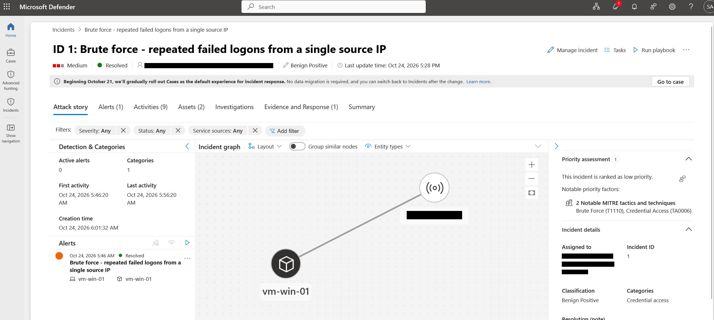

# Azure Cloud SOC Lab: Microsoft Sentinel, Defender for Endpoint, KQL

A hands-on security operations center (SOC) in Azure, built for detection engineering and incident response practice. Logs from a Windows VM flow into a Log Analytics workspace, Microsoft Sentinel (SIEM) raises alerts from custom KQL rules, and Defender for Endpoint covers the host. Each detection is tested by generating the activity on the lab VM, and each incident is written up from alert to closure.

**Stack:** Microsoft Sentinel, Microsoft Defender for Endpoint, Log Analytics, Azure Monitor Agent, KQL, MITRE ATT&CK

## What's in this repo

| Folder | Contents |
|--------|----------|
| [`detections/`](detections/) | Custom KQL analytics rules for Sentinel, each with a header listing data source, MITRE ATT&CK mapping, schedule, threshold and test status, plus a rule template |
| [`incidents/`](incidents/) | Incident write-ups: triage, timeline, queries, containment, closure and lessons learned, plus a template |
| [`screenshots/`](screenshots/) | Portal screenshots of the workspace, its connection to Defender XDR, the onboarded VM in Defender for Endpoint, and incidents, with IDs, IPs and accounts redacted |

**Highlight: [INC-001, RDP brute force (lab test)](incidents/INC-001-rdp-brute-force-lab-test.md).** An authorized test of the brute-force rule: 14 failed RDP logons in 33 seconds, alert 8 minutes after the last attempt, no successful logon from the source IP, closed as benign positive. The write-up covers the timeline, the KQL used to investigate, and what I changed in the rule afterwards.

## How it works

- **Workspace:** one Log Analytics workspace in East US with Microsoft Sentinel enabled on top of it. A budget alert on the subscription keeps the lab cost in check.
- **Data sources:** Azure Activity through a subscription diagnostic setting, Microsoft Entra ID audit logs, and Windows Security events from the lab VM. Entra sign-in logs need a P1/P2 license, so they are not collected here.
- **Lab VM:** Windows Server 2025 in Central US. The subscription had no capacity for the usual small sizes in East US, so the VM runs in another region and still reports to the East US workspace. RDP is limited to my own IP and the VM shuts down every night.
- **Security events:** the Azure Monitor Agent sends a filtered set of Security log events through a data collection rule: logons, special logons, process creation with command line, scheduled tasks, account creation, password resets, additions to security groups, lockouts and log clearing. Removals from groups and account deletions are not collected yet (found in [INC-002](incidents/INC-002-local-admin-added-lab-test.md)). Command-line auditing for process creation is turned on in the VM.

## Roadmap

- [x] Onboard the VM to Defender for Endpoint
- [x] First detection rules in KQL
- [x] Test the brute-force rule end to end and write up the incident ([INC-001](incidents/INC-001-rdp-brute-force-lab-test.md))
- [x] Trigger and document `new-local-admin-added.kql` ([INC-002](incidents/INC-002-local-admin-added-lab-test.md))
- [ ] Add account removal and deletion events (4722, 4726, 4733) to the data collection rule
- [ ] Trigger and document `suspicious-encoded-powershell.kql`
- [ ] Architecture diagram
